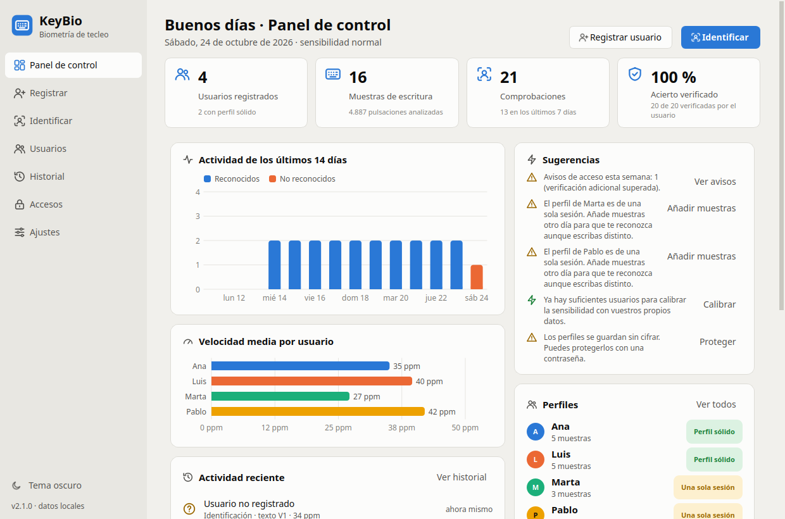
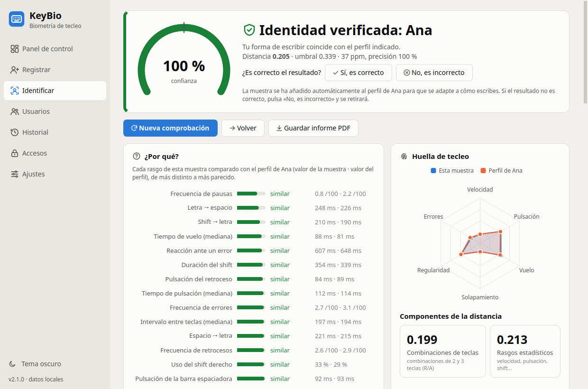

  

<h1 align="center">KeyBio</h1>

  <strong>Te reconoce por cómo escribes.</strong> 
  Biometría de la dinámica de tecleo para Windows, Linux y macOS. Todo se queda en tu equipo.

  <a href="#descargar">Descargar</a> ·
  <a href="#funciones">Funciones</a> ·
  <a href="docs/funcionamiento.md">Cómo funciona</a> ·
  <a href="docs/verificacion-acceso.md">Verificación de acceso</a> ·
  <a href="docs/privacidad-y-datos.md">Privacidad</a> ·
  <a href="docs/README.md">Documentación</a>

KeyBio mide cuánto tiempo mantienes pulsada cada tecla, cuánto tardas en pasar a la
siguiente, qué combinaciones te cuestan más, cómo usas las mayúsculas y cómo corriges los
errores. Con eso crea una **huella de tecleo** de cada persona y la reconoce al escribir un
texto nuevo, sin contraseñas ni cámaras. No envía nada por red.

## Descargar

Los ejecutables de cada versión están en
[*Releases*](https://github.com/ryt0n18/keybio/releases/latest) y en la web del proyecto. No
hace falta instalar Python.

| Sistema | Fichero | Cómo abrirlo |
|---|---|---|
| **Windows** 10/11 (64 bits) | `KeyBio-x.y.z-setup.exe` (instalador) o `KeyBio-windows-x64.zip` (portable) | La primera vez, SmartScreen avisa porque no está firmado: «Más información» → «Ejecutar de todas formas» |
| **Linux** (64 bits): Ubuntu, Debian, Mint | `KeyBio-x.y.z-linux-amd64.deb` | Doble clic para instalarlo (o `sudo apt install ./KeyBio-x.y.z-linux-amd64.deb`) |
| **Linux** (64 bits): otras distribuciones | `KeyBio-linux-x64.tar.gz` | `tar -xzf KeyBio-linux-x64.tar.gz && ./KeyBio/instalar.sh` (sin permisos de administrador) |
| **macOS** 11+ (Apple Silicon) | `KeyBio-x.y.z-macos-arm64.dmg` | Arrastra KeyBio a Aplicaciones; la primera vez, clic derecho → Abrir. En pruebas: aún no se ha probado en un Mac real |

Una vez instalado aparece como cualquier otro programa: en el menú Inicio y el buscador de
Windows, en Launchpad y Spotlight en macOS, y en el menú de aplicaciones en Linux. Desinstalarlo
no borra los perfiles.

Cada versión incluye `SHA256SUMS.txt` para comprobar la descarga (`sha256sum -c SHA256SUMS.txt`).

## Funciones

### Reconocer a las personas

- **¿Quién soy?** Compara tu forma de escribir con todos los perfiles y dice quién eres, o que
  no estás registrado.
- **Soy…** Comprueba si escribes como la persona que dices ser (verificación 1:1).
- **Con cualquier texto.** Un texto nuevo cada vez o **texto libre**: lo que quieras escribir.
- **En directo.** Mientras escribes ves a quién te pareces, y si el resultado ya está claro no
  hace falta terminar el texto.
- **Explica el resultado:** medidor de confianza, comparación rasgo a rasgo, huella de tecleo,
  mapa de calor del teclado y parecido con cada perfil. Se puede guardar como **informe PDF**.

### Verificación de acceso al iniciar sesión

Para sistemas sensibles: `KeyBio --acceso "Ana" --sistema "Nóminas"` pide una frase corta
**solo al iniciar sesión** y devuelve un código de salida (0 = identidad confirmada).

- Guarda **solo la puntuación** de coincidencia; nunca las pulsaciones, el texto, la IP ni el
  nombre del equipo.
- Si no coincide, pide una verificación adicional y deja un **aviso para el administrador**
  en la sección «Accesos».
- Los registros se borran solos a los 30 días.

Detalles, códigos de salida y qué tener en cuenta con trabajadores (RGPD):
[verificación de acceso](docs/verificacion-acceso.md).

### Perfiles que aprenden

- **Registro** con varios textos cortos en el idioma que elijas. Se descartan las muestras
  con demasiados errores o con ritmo no humano.
- **Adaptación automática:** las comprobaciones muy seguras se añaden al perfil, y se deshace
  sola si marcas el resultado como incorrecto.
- **Calibración automática** de la sensibilidad con los datos de vuestro propio equipo.
- **Modo desafío:** alguien intenta imitar a otra persona; KeyBio dice si se ha dejado engañar
  y lo usa para aprender a rechazar imitaciones.

### Seguridad y privacidad

- Todo se guarda en el equipo, opcionalmente **cifrado con contraseña** (AES).
- **Detección de suplantaciones:** ritmo robótico, tiempos repetidos exactos, pulsaciones
  instantáneas y réplicas de una muestra guardada.
- Permiso de la persona antes de registrarla. Más en [privacidad y datos](docs/privacidad-y-datos.md).

### Para el día a día

- **Panel de control** con actividad, calidad de cada perfil, sugerencias y una evaluación del
  sistema con vuestras muestras.
- **Usuarios** con huella de tecleo, mapa de calor, evolución, exportación e informe PDF.
- **Historial** con filtros, búsqueda y exportación a CSV para Excel.
- **En nueve idiomas:** español, inglés, catalán, gallego, euskera, francés, portugués, alemán
  e italiano, con textos para escribir y teclado en pantalla de cada uno.
- Tema claro y oscuro, tamaño de letra, teclado en pantalla que ilumina las teclas, avisos de
  Bloq Mayús y atajos (`Ctrl+1…7` secciones, `Ctrl+T` tema, `F11` pantalla completa).

## Documentación

| | |
|---|---|
| [Cómo funciona](docs/funcionamiento.md) | Qué se mide, cómo decide, sensibilidad y limitaciones |
| [Verificación de acceso](docs/verificacion-acceso.md) | Comprobar la identidad al iniciar sesión |
| [Privacidad y datos](docs/privacidad-y-datos.md) | Qué se guarda, dónde y cómo borrarlo |
| [Desarrollo](docs/desarrollo.md) | Ejecutar desde el código, ejecutables, estructura y pruebas |
| [Cambios](CHANGELOG.md) | Novedades de cada versión |

**Desde el código** (Python 3.10 o superior): `./run.sh` en Linux y macOS, `run.bat` en
Windows. La primera vez instala lo necesario en un entorno virtual. Más en
[desarrollo](docs/desarrollo.md).

## Errores, propuestas y seguridad

Los errores y las propuestas van en las *issues* (ver [cómo contribuir](.github/CONTRIBUTING.md));
los fallos de seguridad, en privado (ver [seguridad](.github/SECURITY.md)). No adjuntes perfiles
ni copias de seguridad: son datos biométricos.

## Licencia

© 2026 Álvaro Ruiz (ryt0n18). Todos los derechos reservados: se pueden usar gratuitamente los
ejecutables publicados, pero no copiar, modificar ni redistribuir el programa sin permiso. Ver
[`LICENSE`](LICENSE). Los componentes de terceros (Qt for Python y Qt bajo la LGPL-3.0, entre
otros) conservan sus licencias, que van en la carpeta `licenses` de los ejecutables.
