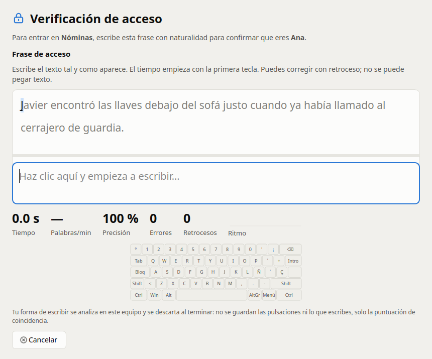
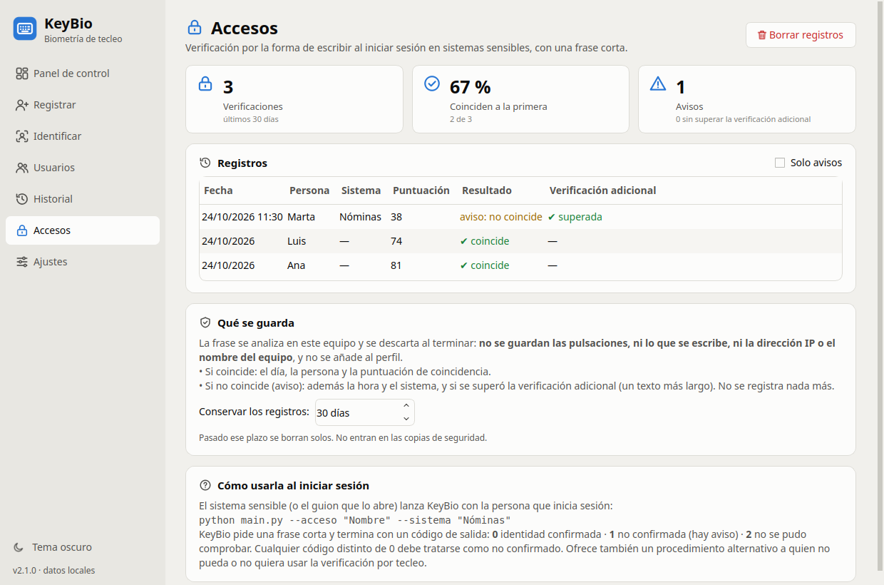

# Verificación de acceso al iniciar sesión

Para sistemas sensibles (nóminas, banca, historiales…), KeyBio puede comprobar la identidad
**solo en el momento de iniciar sesión**, con una frase corta. No hay captura en segundo plano
ni durante el resto de la sesión.



## Cómo se usa

El sistema sensible, o el guion que lo abre, lanza KeyBio con la persona que inicia sesión:

```sh
KeyBio --acceso "Ana" --sistema "Nóminas"      # desde el código: python main.py --acceso ...
```

1. Se abre una ventana con una frase de unos 100 caracteres, elegida al azar.
2. La muestra se compara en el equipo con el perfil de esa persona (verificación 1:1, con la
   sensibilidad de Ajustes) y se descarta.
3. Si coincide, la ventana se cierra sola.
4. Si no coincide, se crea un **aviso para el administrador** y se pide una **verificación
   adicional**: un texto más largo, con el que el resultado es más fiable.

| Código de salida | Significado |
|---|---|
| **0** | Identidad confirmada, con la frase o con la verificación adicional |
| **1** | No confirmada: no coincide y la verificación adicional no se superó o se abandonó (hay aviso) |
| **2** | No se pudo comprobar: persona sin perfil, contraseña de los datos cancelada o ventana cerrada antes de terminar la frase |

Cualquier valor distinto de 0 debe tratarse como **no confirmado**.

## Ejemplos: proteger un programa o una carpeta

KeyBio no se pone solo delante de otros programas: se hace un **lanzador**, un pequeño archivo
que primero llama a KeyBio y solo abre lo protegido si la respuesta es 0. El nombre tiene que
ser el de un perfil registrado en ese equipo (no distingue mayúsculas).

**Linux** (con el `.deb`, el comando es `keybio`; con `instalar.sh`, `~/.local/bin/keybio`):

```sh
#!/bin/sh
keybio --acceso "Ana" --sistema "Nóminas" && exec /ruta/del/programa
```

**Windows** (`start /wait` espera a que se cierre KeyBio y deja su respuesta en `errorlevel`;
si se instaló para todos los usuarios, la ruta es `C:\Program Files\KeyBio\KeyBio.exe`):

```bat
@echo off
start "" /wait "%LOCALAPPDATA%\Programs\KeyBio\KeyBio.exe" --acceso "Ana" --sistema "Nóminas"
if %errorlevel% neq 0 exit /b
start "" "C:\ruta\del\programa.exe"
```

**macOS**:

```sh
#!/bin/sh
/Applications/KeyBio.app/Contents/MacOS/KeyBio --acceso "Ana" --sistema "Nóminas" && open -a "Programa"
```

**Al iniciar sesión en el ordenador**: un lanzador en el inicio automático que bloquee la
pantalla si la respuesta no es 0, por ejemplo `keybio --acceso "$USER" --sistema "Sesión" ||
loginctl lock-session` en Linux, o `rundll32.exe user32.dll,LockWorkStation` en Windows.

Es una **cerradura extra**, no la única: quien tenga conocimientos podría saltarse el lanzador,
así que el programa protegido debe seguir teniendo su propia contraseña.

## Qué se guarda

Los registros van en `access.jsonl`, dentro de la carpeta de datos, cifrados si los datos
tienen contraseña.

| Caso | Se guarda |
|---|---|
| Coincide | El **día**, la persona y la **puntuación** de coincidencia (0–100; 50 es el umbral) |
| No coincide (aviso) | Además la **hora** y el **sistema**, para poder revisar el aviso, y cómo terminó la verificación adicional (superada, no superada o abandonada) |
| Nunca | Las pulsaciones, el texto escrito, la dirección IP ni el nombre del equipo. La muestra no se añade al perfil ni pasa al historial |

- Los registros se borran solos pasados 30 días (el plazo se cambia en la sección «Accesos»),
  al borrar a la persona, y no entran en las copias de seguridad.
- El administrador ve los avisos en la sección **Accesos** y en el panel de control. No se
  envían por red.



## Por qué una frase de unos 100 caracteres

Con poco texto la distancia de una persona a su propio perfil crece y se rechaza a más
usuarios legítimos, y cada rechazo es un aviso sobre alguien que no ha hecho nada. En las
pruebas, por debajo de unas 90 pulsaciones se rechazaba a bastantes más usuarios legítimos; a
partir de ahí la mejora era pequeña y los impostores aceptados apenas cambiaban.

Aun así, de vez en cuando un inicio de sesión legítimo necesitará la verificación adicional.
Son pocas pruebas: conviene revisarlo con más personas.

## Antes de usarla con trabajadores

Orientación, no asesoramiento legal:

- Los datos de tecleo que sirven para confirmar la identidad son **datos biométricos de
  categoría especial** (art. 9 del RGPD), también en la verificación 1:1.
- Hace falta una **base jurídica** válida: el consentimiento del trabajador no suele serlo.
- Hace falta una **evaluación de impacto** (art. 35 del RGPD).
- Hay que **informar a la plantilla** antes de implantarla y pedir el **informe de la
  representación legal** de los trabajadores (art. 64.5 del Estatuto de los Trabajadores).
- Hay que ofrecer **otro método** a quien no pueda o no quiera usarla.
- La carpeta de datos tiene que estar en un sitio que la persona verificada **no pueda
  modificar**.
